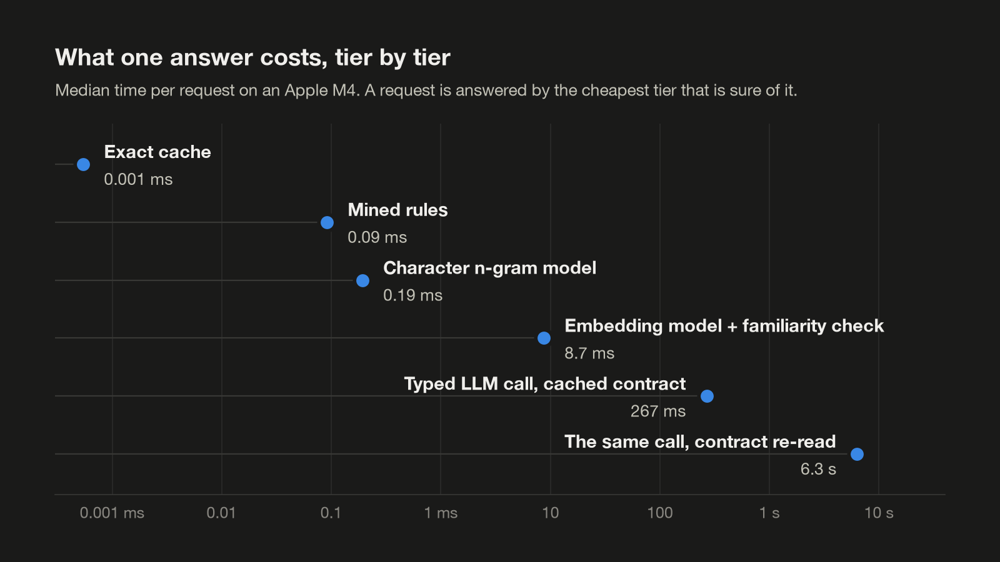
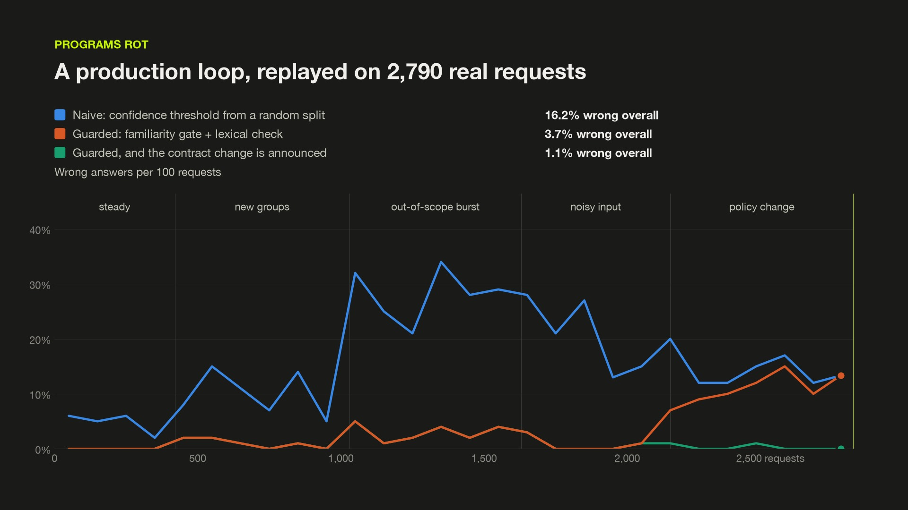
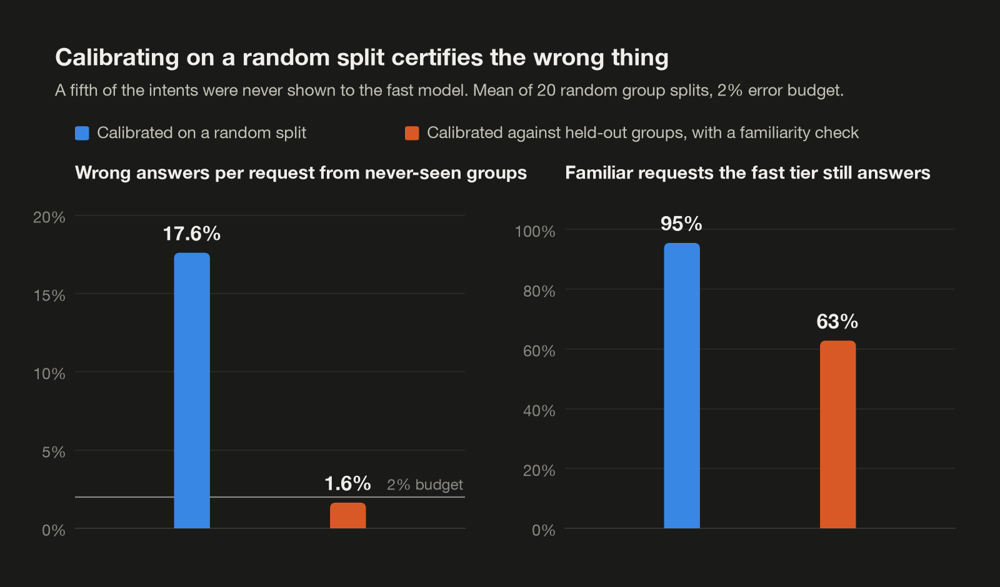
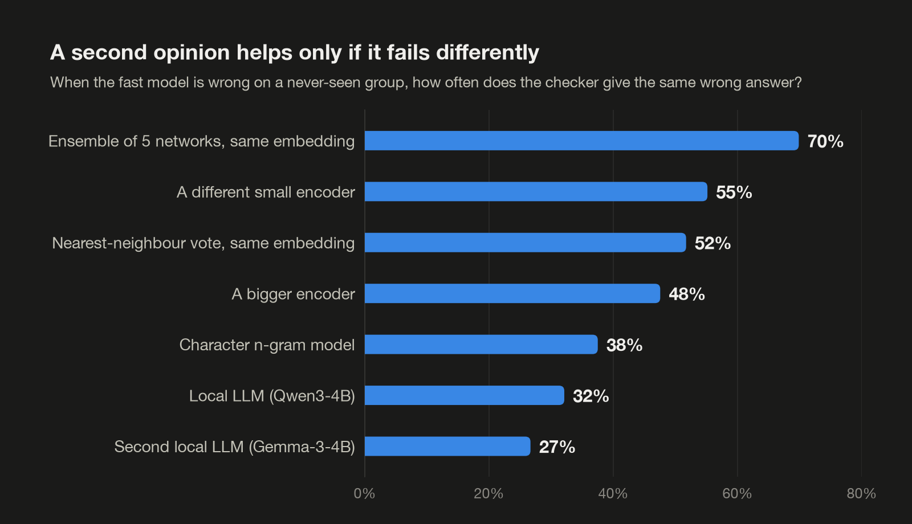
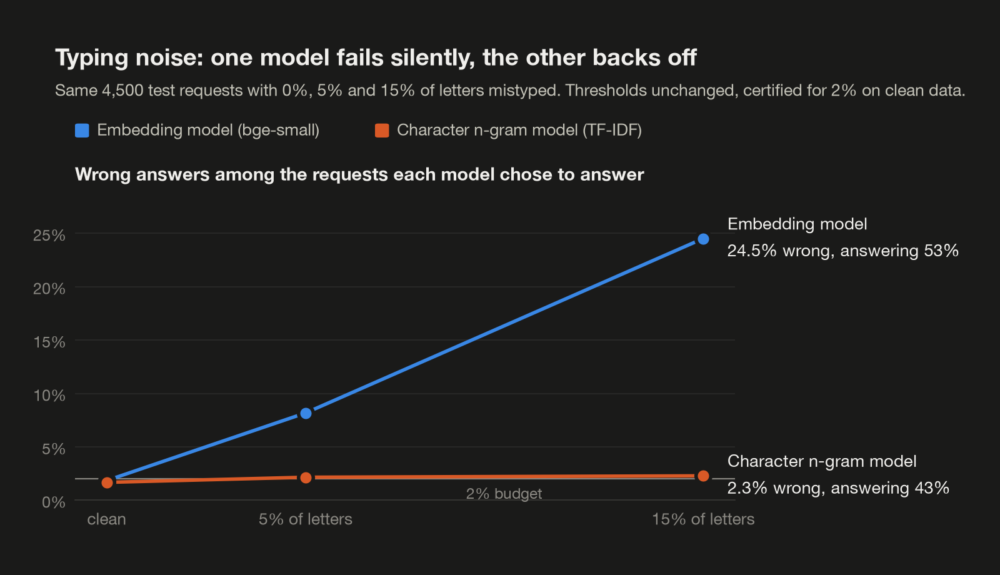
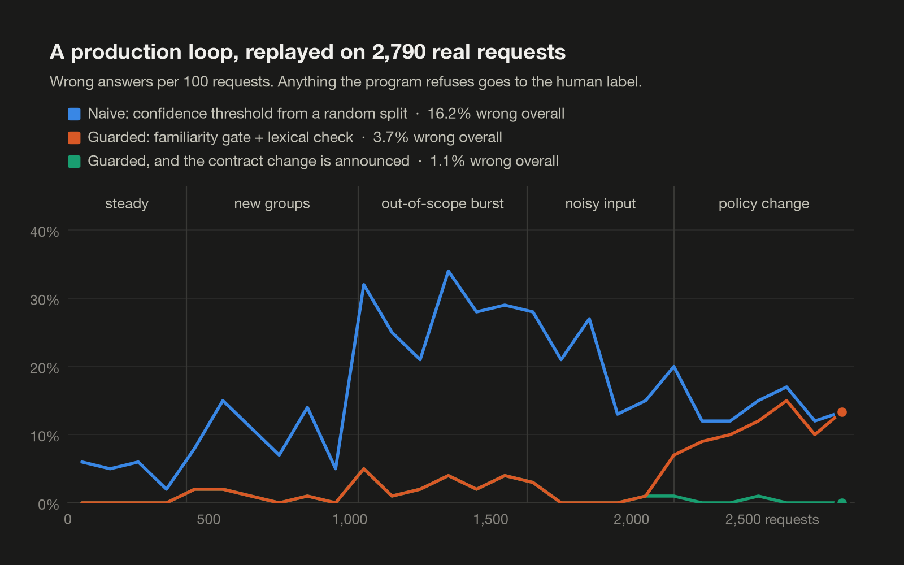
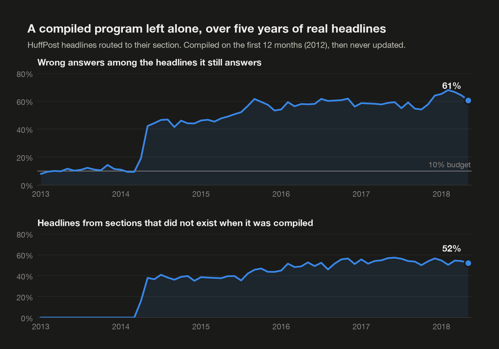
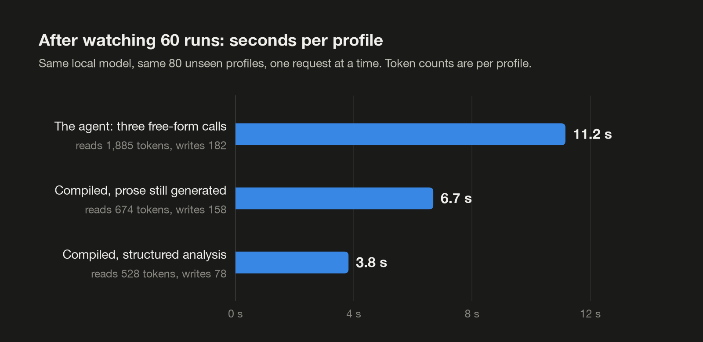

# Agent 2 Program

**Let an agent solve a workflow, then run it as a program.** A skill for coding agents (Claude Code, Codex,
Cursor and others) and the test bed behind it. The skill is a compile procedure with a small runtime: the
deterministic parts of a recurring LLM workflow become code, each judgment becomes a typed decision answered
by the cheapest tier that is sure of it (cache, rules, a small decision model, one narrow LLM call), every
fast answer gets an independent check, and anything the program has not earned the right to answer goes back
to the agent. The test bed is ten experiments on public human-labelled data: nine with real local models, one
with a hosted frontier model as the LLM tier. They
measure where this works and where it fails without telling you.

The earlier projects in this series, [Video 2 GLSL](https://github.com/gokayfem/shader-skills),
[Video 2 Blender Nodes](https://github.com/gokayfem/video-to-blender),
[Video 2 Physics](https://github.com/gokayfem/video-to-physics),
[Video to CSS](https://github.com/gokayfem/video-to-css),
[Image 2 Sculpt](https://github.com/gokayfem/image-to-sculpt),
[Blockout 2 Real](https://github.com/gokayfem/blockout-to-real),
[Image 2 Low Poly](https://github.com/gokayfem/image-to-lowpoly) and
[Reference to Game](https://github.com/gokayfem/reference-to-game), each put an agent through a whole job
every time. This one is about the second time: how much of a job the agent has already done can run without
it, and how you know when it cannot.

Write-up: [Agent 2 Program: What Survives When You Compile an LLM Workflow](https://www.generativemedia.blog/blog/agent-2-program-what-survives-when-you-compile-an-llm-workflow). Every table:
[`REPORT.md`](REPORT.md).

<p align="center"></p>

<p align="center"><sub>What one answer costs at each tier on an Apple M4. A local decision takes 0.2 to 9 ms; one typed call to a local 4B LLM takes 267 ms with the contract as a cached prompt prefix and 6.3 s without it.</sub></p>

<p align="center"><a href="https://www.generativemedia.blog/articles/agent-to-program-film.mp4"></a></p>

<p align="center"><sub>The 38-second film (click to play): the tier ladder, the unseen-group failure, a replay of 2,790 real requests through the production loop, and the harness result.</sub></p>

## Why

Ask for "the same thing again, but faster" and the usual answer is a cache, or a small model trained on the
agent's past answers. Both look fine in a demo. These are the failures that went unnoticed until they were
measured here:

- **A fast model is confidently wrong on groups it has never seen.** Calibrated on a random split it kept a
  2% error promise on familiar groups and, in 20 of 20 random group splits, answered 76% of the
  requests from never-seen groups with 23% of those answers wrong. 68% of those errors were made with a
  confidence of 0.9 or more.
- **Noise and new languages fail silently.** With 15% of letters mistyped, an embedding model was 51%
  accurate and still answered 53% of requests, 24.5% of them wrong. On Turkish versions of English
  requests it answered 26% and got 84% of those wrong.
- **A second opinion trained on the same features repeats the mistake.** When the fast model was wrong, an
  ensemble on the same embedding gave the same wrong answer 70% of the time, a character n-gram model
  38%, an LLM 32%.
- **The LLM fallback is not automatically safe.** A local 4B model took its "none of these" exit for only
  45% of out-of-scope queries and gave an in-scope answer to 10 of 12 prompt-injection strings.
  A frontier model on the same requests took the exit for 96% and answered 1 of 12, so
  measure the model you have.
- **Programs rot.** A router compiled on one year of headlines went from 11% to 65% wrong answers
  over five years, and it was still answering. After a change of policy, 81% of the affected requests were
  answered under the old rule.
- **The agent's own runs contain habits you do not want to compile.** The agent reported a degree for
  33 of 44 profiles that show no education at all. A rule that copied this habit agreed with the
  agent on 70% of runs; the best honest rule agreed on 45%.

The skill gives the agent a procedure that deals with each of these:

- **Contract first.** Inputs, outputs, what varies between runs and what any correct output satisfies are
  written down before any code, with a version. The program is compiled from the contract; the recorded runs
  are evidence.
- **Typed decisions with tiers.** Every judgment is a closed question answered by the cheapest tier that is
  sure: exact cache, mined rules, a small decision model, one typed LLM call with the contract as a cached
  prefix, then the agent. A tier that is not sure abstains.
- **Calibration against the shift you expect.** Whole groups are held out, and the gate must pass two tests:
  selective risk on known groups, and false-accept rate on held-out groups and real out-of-scope inputs. A
  familiarity score separate from confidence does most of the work. Wrong answers per request from unseen
  groups: 17.6% down to 1.6%. Familiar requests still answered: 95% down to 63%.
- **An independent verifier.** A fast answer is never its own check. The default is a character n-gram model
  that must agree: 0.2 ms per request, and it rejects 62% of the fast model's errors on unseen groups.
- **Admission before service.** Held-out cases, whole held-out groups and seeded bad inputs. Every tier is
  admitted, the LLM hole included; a build that fails is refused, and no budget is loosened to pass.
- **Operation.** Shadow sampling, a circuit breaker per answer class, a contract version in every guard,
  regression-gated recompiles, and no retraining on the program's own unverified answers.
- **Compiling from observation.** A wrapper harness records the agent, searches candidate programs for each
  output field, admits one only if it agrees with the agent on runs it never saw, checks the agent's answers
  against its input, and leaves everything else as one narrow typed call.

## What compiles, and what does not

| The step is... | It compiles to... |
|---|---|
| A transform, lookup, calculation or tool call | Code |
| A judgment with a closed answer set, made repeatedly | A typed decision with tiers |
| An extraction the model does approximately (an estimate, a paraphrase) | Usually a narrow typed call; code only if it agrees with the model on runs it never saw |
| Open-ended writing or design | A small generation call fed by compact facts, or a template |
| An irreversible action whose trigger the runs do not pin down | Nothing. It stays with the agent |

"This decision stays with the model" is a valid result. One of three intent tasks could not be certified at a
2% error budget by any model family tested, and 5 of 6 profile fields failed admission as code.

## Install

**Claude Code** (plugin marketplace):

```bash
claude plugin marketplace add gokayfem/agent-to-program
```

```bash
claude plugin install agent-to-program@agent-to-program
```

Or copy the skill: `cp -R skills/workflow-compiler ~/.claude/skills/`.

**Codex, Cursor, Gemini CLI, Copilot and other agents** (via [skills](https://github.com/vercel-labs/skills)):

```bash
npx skills add gokayfem/agent-to-program
```

Or install by hand: copy `skills/workflow-compiler` to `~/.agents/skills/` (Codex) or `~/.cursor/skills/` (Cursor).

**claude.ai:** upload `workflow-compiler-v2.skill` under Settings > Capabilities > Skills.

Requirements: Python 3.10+. The runtime (`scripts/nsp.py`) is standard library only; the threshold procedures
need `numpy` and `scipy`; the decision-model tier needs `scikit-learn`. The skill needs no model API of its
own: it compiles a workflow around whatever agent or LLM you already use.

## Use

Ask naturally, for example:

- *"Here are five logs of you triaging expense lines. Compile that into a script and tell me what still needs a model."*
- *"This prompt classifies support tickets all day. Make it fast without making it wrong on customers it has never seen."*
- *"Analyze these 60 profiles the slow way, record what you do, then turn it into a program and show me which fields became code."*
- *"Is my router's confidence threshold safe for request types that were not in its training data?"*

The result is ordinary Python:

```python
from nsp import Decision, GuardedCache, Hole, Program, check
from decision import DecisionModel, holdout_groups

held = holdout_groups(groups, frac=0.2)                  # whole groups, never trained on
model = DecisionModel(alpha=0.02, embed=encode).fit(
    train_x, train_y,
    seen_x, seen_y,                                      # held-out rows of known groups
    shift_x, shift_y)                                    # held-out groups + real out-of-scope inputs

route = Decision(
    "route", CHOICES,
    cache=GuardedCache(table, key=normalise),
    model=model,                                         # abstains on low confidence or low familiarity
    llm=Hole(call_model, make_prompt, choices=CHOICES),  # contract as a cached prefix
    verifier=lambda x, v, tier: lexical_model(x) == v,   # a differently built second opinion
)

def fn(x, trace):
    check(trace, "is_text", isinstance(x, str))
    check(trace, "contract_version", CONTRACT_VERSION == compiled_for)
    return route(x, trace)

program = Program("router", fn, fallback=agent, oracle=best_oracle,
                  shadow_rate=0.1, queue_path="recompile_queue.jsonl")
```

The full procedure is in [`skills/workflow-compiler/SKILL.md`](skills/workflow-compiler/SKILL.md).

## The evidence

Ten experiments. Nine ran on one Apple M4 with local models; the tenth gave 1,949 of the same held-out
requests to a hosted model, Claude Opus 5.5 at medium effort. 18,529 real answers from the local LLMs are
stored in `cache/llm/`; 20 random group splits were used wherever no LLM was needed. [`REPORT.md`](REPORT.md) has every
table and is generated from `results/*.json`.

| # | Question | What came out |
|---|---|---|
| 1 | Which fast model should take over a typed decision? | A frozen encoder with a linear head answers 94% of CLINC150 and 76% of BANKING77 inside a 2% silent-error budget; nothing could be certified at 2% on MASSIVE. Fine-tuned MiniLM: 96.0% accurate at 4.3 ms. A nearest-neighbour "semantic cache" was the weakest use of an embedding |
| 2 | Can the fast tier tell an input is unfamiliar? | Confidence alone lets 39% of human-written out-of-scope queries through. Relative Mahalanobis distance lets 1.3% through, at the cost of familiar coverage (94% down to 74%) |
| 3 | Does calibration survive groups it never saw? | No with a random split (23% wrong on unseen groups, 20 of 20 splits). Mostly with held-out groups and a familiarity gate (1.6% wrong per unseen request), but it still went over budget in 35% of splits; with 50 calibration groups instead of 10, 20% instead of 40% |
| 4 | What can verify a fast answer, and at what cost? | Agreement with a character n-gram model: 0.2 ms, rejects 62% of unseen-group errors. Checkers on the same embedding repeat the mistake. The cost of a verifier is its false rejects |
| 5 | How good is the LLM tier, and whole stacks? | Qwen3-4B: 95% on familiar requests, 78% on unseen groups, "none" exit on 45% of out-of-scope queries. A guarded fast tier in front of it: 11.4% wrong against 12.4% for always-LLM, with 0.46 calls per request. Zero-shot on 150 intents the LLM scores 75% against 96% for the trained fast model; on Spanish versions of familiar requests it scores 73% against 36% |
| 6 | What happens in a production loop with drift? | Over 2,790 replayed requests: naive 16.2% wrong, guarded 3.7%, guarded with the contract change announced 1.1%. After the policy change 81% of the re-routed requests were answered under the old rule; re-checking 10% of fast answers did not catch it within the 640 requests that followed, re-checking 40% took 200. Ungated self-training was the worst policy |
| 7 | And under natural drift? | Five years of dated headlines: a static program goes from 11% to 65% wrong among its answers. A shadow breaker opens in 2014-05. Gated quarterly recompiles stay at 8.4% but keep only 9% coverage |
| 8 | Does a real compiled program pass admission? | The full build is refused: 17.3% silent errors, 85 of 251 from the LLM tier and 7 of 281 from the local tiers. Without the LLM and rule tiers it is admitted at 0.8%, answering 42% locally. A naive gate answers 46 of 60 gibberish strings; the guarded gate none |
| 9 | Can a wrapper harness compile an agent from its runs? | After 60 recorded runs of a three-call profile analysis: 3.8 s per profile instead of 11.2 s (6.7 s if prose is still generated). 1 of 6 short fields became pure code; the rest is one narrow typed call reading 528 tokens instead of 1,885 |
| 10 | Does a frontier model as the LLM tier change the picture? | Claude Opus 5.5 (medium effort) on 1,949 of the same requests: 95% right on never-seen groups against 78% for the local model, "none" exit on 96% of out-of-scope queries against 47%, an in-scope answer to 1 of 12 prompt-injection strings against 11. Always asking it is 1.0% wrong; the guarded fast tier in front of it is 1.8% wrong and saves 55% of the calls; a naive fast tier in front of it is 9.2% wrong. Answered in batches through subagents, so no latency or cost |

<p align="center"></p>

<p align="center"><sub>Experiment 3. Left: wrong answers per request from groups the fast model never saw. Right: what the fix costs on familiar traffic. Means over 20 random group splits, 2% budget.</sub></p>

<p align="center"></p>

<p align="center"><sub>Experiment 4. How often a second opinion repeats the fast model's mistake. The more differently a checker is built, the less it agrees with the error.</sub></p>

<p align="center"></p>

<p align="center"><sub>Experiment 2. The same test requests with more and more mistyped letters. Both thresholds were certified on clean data and never changed.</sub></p>

<p align="center"></p>

<p align="center"><sub>Experiment 6. Wrong answers per 100 requests across the five scripted phases. Guards handle unfamiliar inputs; they cannot see a change of rules.</sub></p>

<p align="center"></p>

<p align="center"><sub>Experiment 7. A program compiled on 2012 headlines and never updated, month by month.</sub></p>

<p align="center"></p>

<p align="center"><sub>Experiment 9. Seconds per profile on 80 unseen profiles, same local model, one request at a time.</sub></p>

### What is measured and what is assumed

| Kind | What |
|---|---|
| Measured | All fast-model training and inference; every LLM answer and latency (Qwen3-4B and Gemma-3-4B, 4-bit, on this machine); the three-call agent and the compiled program of experiment 9; every accuracy, coverage and error figure against human labels |
| Replayed | Experiments 5, 6 and 8 look up the stored real LLM answer for each exact request instead of calling the model again; per-request latency in the stack and loop tables is assembled from measured per-tier medians |
| Scripted | The order and mix of traffic in experiment 6, the traffic mixes in experiment 5, the seeded bad inputs, the keyboard noise |
| Assumed | The agent tier: wherever a request is escalated, the human label is taken as the agent's answer and assumed correct. Escalations are counted, never timed |
| Real answers, different protocol | Experiment 10: Claude Opus 5.5 (medium effort) answered through Claude Code subagents in blind batches of about 220 requests, not one API call per request. No latency, no token probabilities, no measured cost |
| Not run | Any hosted model through its API; any OpenAI model; an agent with tools; GPU latency for the fast tier; real production traffic with repeats |

## Limits

- **Outside experiment 10 the LLMs are 4-bit local models of about 4B parameters.** Every other statement about
  the LLM tier is about them. Experiment 10 is one hosted model at one effort setting on one frozen split,
  answered in batches, with no latency or cost measured.
- **The agent is the human label.** Those labels are themselves imperfect, visibly so on MASSIVE and on the
  news sections.
- **One frozen group split carries the LLM-in-the-loop results** (experiments 4, 5, 6 and 8). The fast-tier
  conclusions were checked on 20 splits; the LLM ones were not.
- **Short-text, closed-answer tasks only.** Nothing here tests perceptual workflows such as video to Blender,
  where the verifier is the hard part.
- **The harness was tested on one workflow.** Its candidate programs were written by the coding agent after
  reading the observed runs; search, admission and scoring were mechanical. 60 runs are far too few to
  certify a decision model for the closed-set fields, so that step was not tested.
- **A certificate is an estimate.** Calibration against held-out groups went over budget in 35% of splits
  because rows from one group fail together. Shadow sampling stays on.

## Reproduce

```bash
python3.12 -m venv .venv && .venv/bin/pip install -r requirements.txt
```

```bash
.venv/bin/python -m bench.data                 # download datasets, write split manifest
.venv/bin/python -m bench.precompute           # embed everything (CPU, ~15 min)
.venv/bin/python -m bench.exp1_families        # model families
.venv/bin/python -m bench.exp1b_finetune       # end-to-end fine-tune (CPU, ~8 min)
.venv/bin/python -m bench.exp2_novelty         # unfamiliar inputs, typos, locale shift
.venv/bin/python -m bench.exp3_group_shift 20  # calibration x held-out groups, 20 splits
.venv/bin/python -m bench.exp3b_cal_groups     # how many calibration groups are needed
.venv/bin/python -m bench.exp7_news_drift      # natural drift
.venv/bin/python -m bench.label_llm route policy verify gemma latency bad fine massive   # real LLM answers (GPU, ~50 min)
.venv/bin/python -m bench.exp_latency          # per-request latency of local tiers
.venv/bin/python -m bench.exp4_verification
.venv/bin/python -m bench.exp5_tiers
.venv/bin/python -m bench.exp5b_llm_other      # the LLM on fine-grained holes and on a new language
.venv/bin/python -m bench.exp6_stream
.venv/bin/python -m bench.exp8_kernel
.venv/bin/python -m bench.exp9_harness collect # the agent the harness observes (GPU, ~25 min)
.venv/bin/python -m bench.exp9_harness run     # compile from traces, run compiled program
.venv/bin/python -m bench.exp10_closed prepare <dir>              # write blind batch files for a hosted model
.venv/bin/python -m bench.exp10_closed ingest <dir> <model-key>   # read its answers back
.venv/bin/python -m bench.exp10_closed score <model-key>          # same rows, same scoring as the local LLM
.venv/bin/python -m bench.make_report          # REPORT.md
.venv/bin/python -m bench.make_readme          # this file
```

The LLM stages need Apple Silicon (MLX) and are resumable: answers are appended to `cache/llm/`, keyed by
model, prompt version and exact query text, so the experiments that replay them run anywhere. Run one GPU job
at a time; two MLX processes sharing the GPU each ran about three times slower. Seeds are fixed and LLM
decoding is greedy. Datasets are downloaded on first use into `data/raw/`.

Kernel tests: `.venv/bin/python -m unittest discover -s tests` (21 tests). Skill tests:
`cd skills/workflow-compiler && python -m unittest discover -s tests` (23 tests).

## Layout

| Path | What |
|---|---|
| `skills/workflow-compiler/` | the skill: `SKILL.md`, runtime (`scripts/nsp.py`), threshold procedures (`selective.py`), decision-model tier with two-test calibration (`decision.py`), admission harness (`admit.py`), tests |
| `workflow-compiler-v2.skill` | the same skill as one file, for claude.ai |
| `REPORT.md` | the experimental report, generated from `results/` |
| `results/` | one JSON per experiment, plus `data_manifest.json` with a fingerprint of every split |
| `bench/` | datasets, encoders, model families, the local-LLM tier, one module per experiment, and the generators for `REPORT.md` and this file |
| `wfc/`, `tests/` | the runtime kernel the experiments import, and its tests |
| `cache/llm/` | every stored real LLM answer: model, prompt version, exact query, raw reply, token probability |
| `cache/closed/` | experiment 10: the batch files given to the hosted model, its answers, and the scoring key |
| `gallery/` | the figures above |
| `blog/` | the scripts that draw the figures and the film from `results/` |
| `logs/pip_freeze.txt` | exact package versions of the run |

## Corrections

- **11 November 2026, experiment 6.** The first version counted applications for a new credit card as requests
  re-routed by the policy change. The policy text does not cover them, and both LLMs given the changed contract
  kept most of them where they were. The phase was rerun with the three request types the policy names. Withdrawn:
  65% of re-routed requests answered under the old rule, detection after 400 requests at a 10% shadow rate, the
  naive program at 21.4% wrong overall, the guarded one at 6.7%. Current numbers are in the table above and in
  [`REPORT.md`](REPORT.md). The production-loop figure was redrawn.

## Credits

Experiments designed and run with Claude Fable 5.2 in Claude Code on local hardware.

Data: [CLINC150](https://github.com/clinc/oos-eval) (Larson et al., 2019),
[BANKING77](https://github.com/PolyAI-LDN/task-specific-datasets) (Casanueva et al., 2020),
[MASSIVE](https://github.com/alexa/massive) (FitzGerald et al., 2022), the
[News Category Dataset](https://huggingface.co/datasets/heegyu/news-category-dataset) (Misra, 2022) and the
[opensporks/resumes](https://huggingface.co/datasets/opensporks/resumes) profiles. `cache/llm/` quotes request
texts from CLINC150, BANKING77 and MASSIVE next to the model's answers; those texts belong to their datasets
and stay under the datasets' own licences.

Models: Qwen3-4B-Instruct-2507 and Gemma-3-4B-it (4-bit, via MLX) for the LLM tier; all-MiniLM-L6-v2,
bge-small-en-v1.5, bge-base-en-v1.5, multilingual-e5-small and potion-base-8M for the fast tier.

## License

MIT for the code, results and report.
